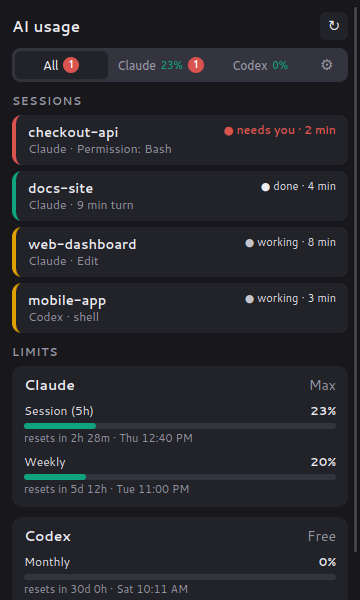
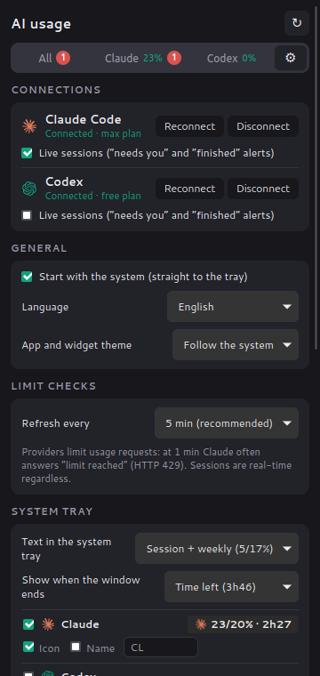
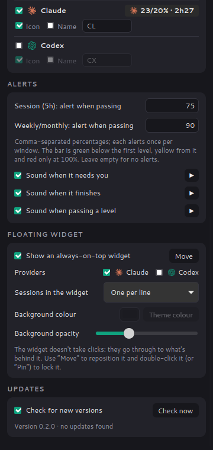
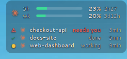

# AI Usage

[](https://github.com/juan-silveira/ai-usage/actions/workflows/ci.yml)

A system-tray monitor for AI coding subscriptions (Claude Code, OpenAI Codex, …)
on **Linux, Windows and macOS**. It shows:

- **Usage limits**: the same numbers as Claude Code's `/usage` — the 5-hour
  window, the weekly (or, on Codex Free, monthly) limit, per-model limits, and
  when each one resets.
- **Live sessions** (through the agents' hooks): every open Claude Code / Codex
  session, whether it is working, done or **waiting for you** — with a desktop
  notification right away and a reminder every 2 minutes until you answer.


<table>
  <tr>
    <td align="center"><br /><sub>Sessions and limits</sub></td>
    <td align="center"><br /><sub>Connections and system tray</sub></td>
    <td align="center"><br /><sub>Alerts, widget and updates</sub></td>
  </tr>
</table>

<p align="center"><br /><sub>Floating widget (click-through, always on top)</sub></p>

It needs no password or account of its own: it reuses the credentials the
CLIs already store on your machine, **read-only** (it never refreshes or
rewrites tokens, so it can't sign the CLI out).

## Languages

The interface is available in 15 languages — English, Português (Brasil),
Español, Français, Deutsch, Italiano, Русский, Polski, Türkçe, 简体中文, 日本語,
한국어, हिन्दी, Bahasa Indonesia and Tiếng Việt. It follows the system language
or the one chosen in Preferences → General.

Translations live in [`crates/core/locales/`](crates/core/locales), one JSON
file per language, with `en.json` as the reference. A test checks that every
locale has every key and the same `{placeholders}`, so adding a language is
one file plus one line in `crates/core/src/i18n.rs`.

## Install

Download the installer for your system from
[Releases](https://github.com/juan-silveira/ai-usage/releases):
`.deb`/`.rpm`/`.AppImage` (Linux), `.msi`/`-setup.exe` (Windows) or `.dmg`
(macOS — `aarch64` for Apple Silicon, `x64` for Intel). The builds are not
signed: on macOS right-click the app → Open; on Windows, "More info" → "Run
anyway".

## Features

### System tray

One item per provider, like a weather applet: logo + usage (e.g. `✳ 7/17%`).
In the preferences you choose the number (highest usage, 5h session,
session + weekly, or just the app icon), whether to show when the window ends
(time left or time of day) and, per provider, whether to show the item, the
logo and a custom name. When a session is waiting for you the item gets `⚠1`.

Left-click toggles the window; right-click opens the menu (refresh now,
quit). Closing the window keeps the app in the tray.

On Cinnamon (Linux Mint) the app uses the native XApp status icon (through
libxapp), because `xapp-sn-watcher` drops the text of AppIndicator icons. On
macOS the text is shown next to the icon; Windows trays only show the icon and
a tooltip.

### Connections

Preferences → Connections shows each provider's status (connected + plan,
sign-in expired, not connected) with:

- **Connect / Reconnect**: runs the CLI's official sign-in (`claude auth
  login`, `codex login`), which opens the browser; if it doesn't, the app
  shows the link and a field to paste the code if the CLI asks for one.
  Without the CLI installed, it shows the install command. The CLIs are found
  even outside the desktop's PATH (asdf, nvm, volta, global npm).
- **Disconnect**: runs `claude auth logout` / `codex logout` after a
  confirmation — this also signs the CLI out in the terminal, since the app
  uses the CLI's credentials.
- **Live sessions**: installs or removes the hooks. They call the app's own
  executable (`ai-usage-app hook claude`), so the `ai-usage` CLI isn't needed.

### Alerts

Usage levels, separate for the 5-hour session and the weekly/monthly window
(e.g. session `80, 95`, weekly `90`): each level notifies once per window,
with its own sound, and sets the colours — green below the first level,
yellow from it and red only at 100%.

Sounds are generated by the app (no audio files): a short, insistent bell when
a session needs you and an arpeggio when it finishes. Each one can be turned
off or previewed in the preferences.

### Floating widget

An optional transparent window that stays on top and lets clicks through to
whatever is behind it. Use "Move" in the preferences, drag it, and
double-click to pin it again. You can pick which providers it shows, the
background colour and opacity (the text follows the colour's brightness), and
whether sessions appear as a summary ("2 working"), one per line (project,
state and time, most urgent first) or not at all.

### Everything else

- Starts with the system (on by default on the first run, straight to the
  tray), with a light/dark/follow-the-system theme for the window and widget.
- Checks GitHub releases at startup and every 12 hours, and announces new
  versions (banner + notification with a download link).
- The usage endpoints are rate limited: limits are checked every 5 minutes by
  default (configurable). On HTTP 429 the app honours `Retry-After` (1–30 min,
  with exponential backoff) and keeps showing the last data, marked as stale.
  The state is cached on disk and shared by the app and the CLI, so restarting
  the app doesn't cause extra requests.

## Providers

| Provider | Credentials read | Endpoint |
|---|---|---|
| Claude | `~/.claude/.credentials.json` (or `$CLAUDE_CONFIG_DIR`); on macOS, Keychain `Claude Code-credentials` | `GET api.anthropic.com/api/oauth/usage` |
| Codex | `~/.codex/auth.json` (or `$CODEX_HOME`) | `GET chatgpt.com/backend-api/wham/usage` |

Both endpoints are internal/undocumented and may change. Usage windows are
classified by their length, so plans with different windows (Codex Free has a
single 30-day window; Plus/Pro have 5-hour and weekly ones) are labelled
correctly. To add a provider, implement the `Provider` trait in
`crates/core/src/providers/` and register it in `all_providers()`.

## Sessions

`ai-usage hook <claude|codex>` is registered as a hook of the agents. On each
event (prompt sent, tool used, permission request, turn finished, session
ended) it writes a small JSON file per session to
`~/.local/state/ai-usage/sessions/` (Linux),
`~/Library/Application Support/ai-usage/sessions/` (macOS) or
`%LOCALAPPDATA%\ai-usage\sessions\` (Windows). The app reads that folder every
2 seconds; the hook never fails or prints anything, so it can't get in the
agent's way, even with the app closed.

| Agent event | State |
|---|---|
| `SessionStart` | idle |
| `UserPromptSubmit`, `PreToolUse`, `PostToolUse` | working |
| `Notification` (permission/question), `PermissionRequest` | **needs you** → alert + reminder every 2 min (max. 5) |
| `Stop` | done → alert (🎉 if the turn took ≥ 5 min) |
| `SessionEnd` | removed |

Clicking a "needs you" session in the window silences its reminders.

```sh
cargo install --path crates/cli   # installs ~/.cargo/bin/ai-usage
ai-usage hooks install            # Claude (~/.claude/settings.json) and Codex (~/.codex/hooks.json)
ai-usage hooks install claude     # a single provider
ai-usage hooks status
ai-usage sessions                 # list sessions in the terminal
ai-usage hooks uninstall          # removes only ai-usage's entries
```

Installing merges with what is already there (other hooks and settings are
left alone), is idempotent and keeps a `*.ai-usage.bak` backup of the
original file.

## Development

```
crates/core      Rust library: providers, data model, HTTP, translations
crates/cli       `ai-usage` — prints usage in the terminal or as JSON
app/src-tauri    desktop app (Tauri 2): tray + floating windows
app/ui           static frontend (HTML/CSS/JS, no build step)
```

### CLI

```sh
cargo run -p ai-usage-cli              # table
cargo run -p ai-usage-cli -- --json    # JSON (scripts, status bars, displays)
cargo run -p ai-usage-cli -- --watch 60
```

The CLI follows `LANG`/`LC_ALL` (e.g. `LC_ALL=ja_JP.UTF-8 ai-usage`).

### Desktop app

Requirements: a recent stable Rust ([rustup](https://rustup.rs)) and the
[Tauri dependencies](https://v2.tauri.app/start/prerequisites/) for your OS.
On Ubuntu/Debian:

```sh
sudo apt install libwebkit2gtk-4.1-dev libayatana-appindicator3-dev librsvg2-dev libxdo-dev libssl-dev
```

```sh
cargo run -p ai-usage-app                 # development
cargo install tauri-cli --version '^2'    # once
cd app/src-tauri && cargo tauri build     # installers (.deb/.AppImage, .msi, .dmg)
```

### CI and releases

- `.github/workflows/ci.yml` — on every push/PR: `cargo fmt --check`,
  `clippy -D warnings` and tests on Linux; build + tests on Windows and macOS.
- `.github/workflows/release.yml` — pushing a `vX.Y.Z` tag (matching the
  workspace `version` in `Cargo.toml`) builds the installers for the three
  systems and creates a **draft** release with them. Review it and click
  "Publish": the app only sees published releases.

```sh
# after updating version in Cargo.toml and tauri.conf.json
git tag v0.2.0 && git push origin v0.2.0
```

## Roadmap

- [x] Live session state through hooks, with alerts and reminders
- [x] Usage in the system tray with provider logo and custom name
- [x] Sound alerts
- [x] Usage alert levels per window
- [x] Transparent, click-through floating widget
- [x] New version notice (GitHub Releases)
- [x] Start with the system
- [x] Connect/disconnect (official CLI sign-in) and hooks from the app
- [x] Light/dark theme
- [x] CI with builds for the three OSes
- [x] Interface in 15 languages
- [ ] Focus / meeting mode (mute alerts), configurable sounds
- [ ] Clicking the notification focuses the session's terminal
- [ ] Local API (HTTP/WebSocket) for external widgets and displays
- [ ] More providers: Gemini CLI, Cursor, Copilot, OpenRouter
- [ ] Automatic updates (tauri-plugin-updater + signed releases in CI)
- [ ] Code signing (macOS notarization, Windows Authenticode)

## References

Projects that helped discover the endpoints:
[CodexBar](https://github.com/steipete/CodexBar),
[Win-CodexBar](https://github.com/nesszer/Win-CodexBar),
[Claude-Code-Usage-Monitor](https://github.com/CodeZeno/Claude-Code-Usage-Monitor).

## Credits

Claude and OpenAI logos: [Simple Icons](https://simpleicons.org) (CC0).
Trademarks belong to their respective owners.

## License

MIT
